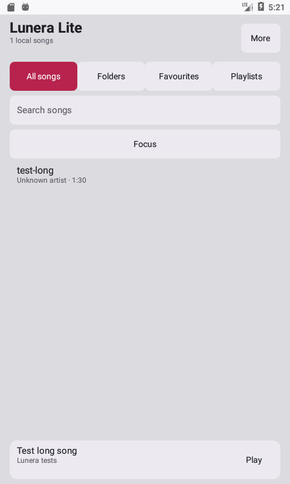

<p align="center"></p>
<h1 align="center">Lunera Lite</h1>
<p align="center">Your music, kept simple.</p>
<p align="center">A local music player for Android 6.0 and newer, maintained within Grimmoir Organization.</p>
<p align="center"><a href="https://github.com/Grimmoir-Organization/Lunera-Lite/releases">Download APK</a> · <a href="docs/FEATURES.md">Features</a> · <a href="LICENSE">GPL-3.0</a></p>

Lunera Lite uses a small native Android interface and the system audio engine. It keeps local playlists, lyrics, custom backgrounds and useful playback controls without decorative animations or scheduled background scanning.

## Features

- All songs, folders/subfolders, search, sorting, favourites and editable playlists.
- Focus button to find the current or last-played song.
- Editable queue, shuffle/repeat and saved playback position.
- Background playback with notification, lock-screen and headset controls.
- Sleep timer with an optional finish-current-song setting.
- Embedded/imported local lyrics, synchronized highlighting and timing edits.
- Embedded/custom artwork, custom backgrounds, themes and accent colours.
- Folder/duration filters, manual rescan and manual update check.

**Removing Lite from Recents stops playback.** Switching apps or locking the screen keeps music playing. There is no app-provided notification X button. Playback speed is excluded.

Hold a song to open favourite, playlist, queue, lyrics and artwork options. Hold a queue item to move or remove it. Hold a folder to exclude it and its subfolders.

The minimum version is Android 6.0 (API 23). See [testing](docs/TESTING.md) for the versions actually verified and remaining limits; a minimum SDK is not a claim that every phone has been tested.

## Screenshot



Android 6 emulator with generated test audio and an imported test background. Test music and test images are not bundled in the APK.

## Install

Download `Lunera-Lite-1.0.0.apk` from Releases and allow installation from your browser/file manager. Grant audio access so Lite can scan local files. On Android 13+, allow notifications for playback controls. Lite has its own package and installs alongside regular Lunera.

## Build

Requirements: JDK 17, Android SDK platform 35 and Build Tools 35.0.0. Gradle 8.10.2 is pinned by the wrapper and verified with its SHA-256 checksum.

```sh
./gradlew :app:assembleDebug :app:lintDebug
sh scripts/test-core.sh
```

On Windows use `gradlew.bat :app:assembleDebug :app:lintDebug`. A release can be produced using `:app:assembleRelease`; sign it with your private release key. The public repository contains no signing credentials.

The dependency-free fallback build uses the same Java source and resources:

```sh
export JAVA_HOME=/path/to/jdk-17
export ANDROID_HOME=/path/to/android-sdk
python3 scripts/build-sdk.py
```

It produces an unsigned APK under `app/build/sdk/`. Sign and verify it using Android SDK `apksigner` before distribution.

For on-device regression checks, see [testing](docs/TESTING.md). Source archives contain project files, the Gradle wrapper, documentation and assets. SDKs, caches, build outputs, APKs and signing keys are excluded.

## License and credits

GPL-3.0; see [LICENSE](LICENSE). A Lunera project maintained within Grimmoir Organization. Contributors: [dinesh2068](https://github.com/dinesh2068) and [rufusgrimmoir](https://github.com/rufusgrimmoir).

The Lunera crescent/music-note logo is retained from Lunera. This Lite implementation is a new native Android implementation of the selected Lunera features; regular Lunera's eight-module source remains a separate project. The Gradle wrapper is distributed under the Apache License 2.0; see [third-party notices](NOTICE.md).
